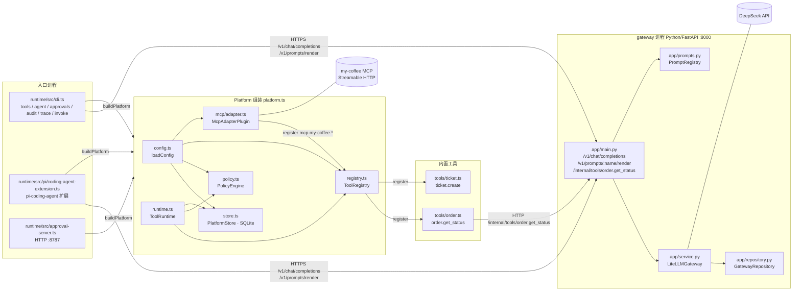
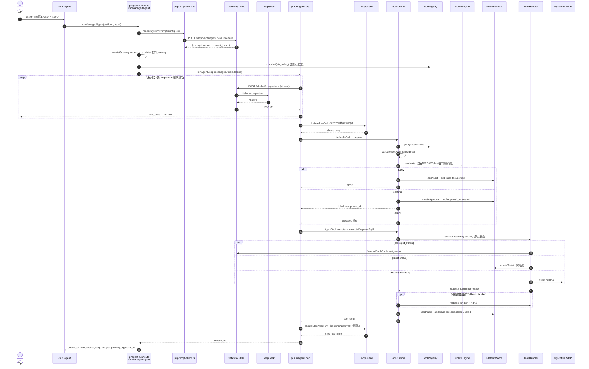
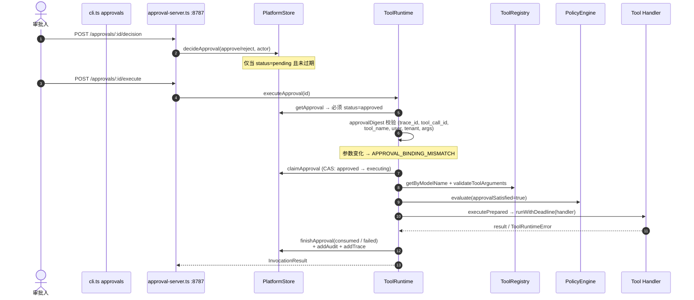

# Agent Tool Runtime on pi

本项目把阶段一的 LiteLLM 统一模型网关，升级为基于 pi 的 Agent 工具调用基础设施。模型、CLI、`pi-coding-agent` 扩展和审批 API 共用同一个 `ToolRuntime`；正式 MCP 连接 `my-coffee`。

## 1. 环境

- Python 3.12+
- Node.js 22.19+
- DeepSeek API Key
- 瑞幸 MCP Token

```bash
cp .env.example .env
# 手工将四个值写入当前终端环境；项目不会自动读取或提交明文 .env。
export DEEPSEEK_API_KEY="..."
export GATEWAY_API_KEY="..."
export APPROVAL_API_KEY="..."
export LUCKIN_MCP_TOKEN="..."
```

正式 MCP 配置位于 `config/platform.yaml`：

```yaml
mcp_servers:
  - id: my-coffee
    type: streamablehttp
    url: https://gwmcp.lkcoffee.com/order/user/mcp
    headers:
      Authorization: Bearer ${LUCKIN_MCP_TOKEN}
```

## 2. 安装与启动

```bash
python -m venv .venv
.venv/bin/pip install -e 'gateway[dev]'
cd runtime && npm ci && cd ..

GATEWAY_CONFIG=config/gateway.yaml \
  .venv/bin/python -m uvicorn app.main:app --app-dir gateway --host 127.0.0.1 --port 8000
```

另开终端：

```bash
cd runtime
npm run cli -- tools
npm run cli -- agent "查询订单 ORD-A-1001 的状态"
npm run approval-api
```

`tools` 和 `agent` 默认连接正式 `my-coffee`。只验收本地工具时显式加 `--without-mcp`，这不会替换正式 MCP，仅用于隔离测试。

## 3. 审批

模型发起高风险工具后，Loop 停止并返回 `pending_approval_id`。审批与参数摘要、用户、租户、Trace 和 Tool Call 绑定，参数变化会使旧审批失效。

```bash
npm run cli -- approvals list
npm run cli -- approvals decide <approval-id> --decision approve --actor teacher
npm run cli -- approvals execute <approval-id>
```

审批 API：

```bash
curl -H "Authorization: Bearer $APPROVAL_API_KEY" http://127.0.0.1:8787/approvals?status=pending
curl -X POST -H "Authorization: Bearer $APPROVAL_API_KEY" \
  -H 'Content-Type: application/json' \
  -d '{"decision":"approve","actor":"teacher"}' \
  http://127.0.0.1:8787/approvals/<approval-id>/decision
curl -X POST -H "Authorization: Bearer $APPROVAL_API_KEY" \
  http://127.0.0.1:8787/approvals/<approval-id>/execute
```

## 4. pi 两种入口

Headless 产品入口：

```bash
npm run cli -- agent "帮我完成任务"
```

交互式 Coding Agent 入口：

```bash
npm run pi:managed -- \
  --managed-user-id trainer-1 \
  --managed-tenant-id tenant_a \
  --managed-roles supervisor \
  --managed-mode plan
```

## 5. 测试

```bash
cd runtime
npm run build
npm test
npm run test:mcp

cd ../gateway
../.venv/bin/pytest

cd ../runtime
npm run test:live       # 缺 DEEPSEEK_API_KEY 时必须失败，绝不回退到假模型
npm run test:mcp:live   # 缺 LUCKIN_MCP_TOKEN 时必须失败
```

确定性测试覆盖 Schema、Registry、RBAC、租户边界、审批绑定、幂等、重试、降级、脱敏、Trace、Loop Budget 与 MCP Adapter。`test:live` 才是模型决策验收，必须真实调用 DeepSeek。

## 6. 安全约束

- Tool Call 是候选动作，不是可信指令。
- `my-coffee` 未知远端工具默认 `high` 风险并要求确认。
- Token 只从环境变量读取，审计层按敏感字段和通用密钥字段脱敏。
- 只有幂等且可重试的调用才自动重试；流式输出已经发出后不切换模型。
- pi Hook 修改后的参数不会由 pi 自动重验，因此 handler 前统一由 `ToolRuntime` 再验证。
- 审计写入失败不能改变已经完成的业务副作用；生产环境应将审计发送到独立可靠队列。

## 7. 调用链路

### 7.1 组件与依赖



### 7.2 Agent Loop 主链路（`npm run cli -- agent`）



### 7.3 审批执行链路（`approvals decide` → `execute` / Approval API）



CLI 的 `approvals decide` / `approvals execute` 与 Approval API 走完全相同的 `PlatformStore` + `ToolRuntime.executeApproval` 路径，只是入口不同；`invoke` 子命令绕过模型但仍走 `ToolRuntime.invoke`，用于确定性验收。

